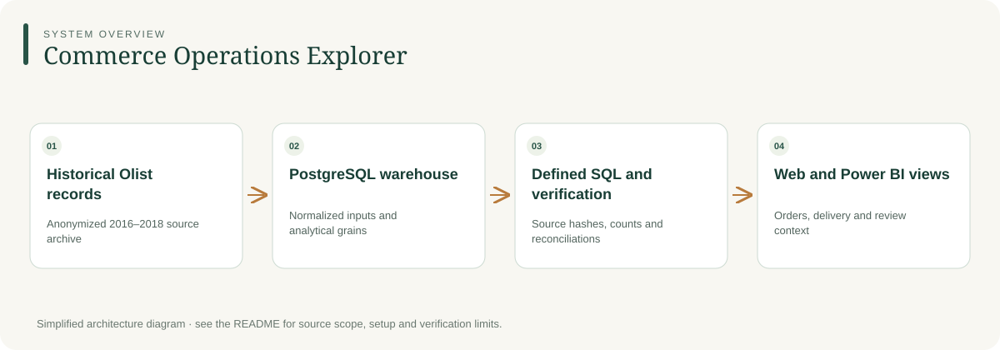
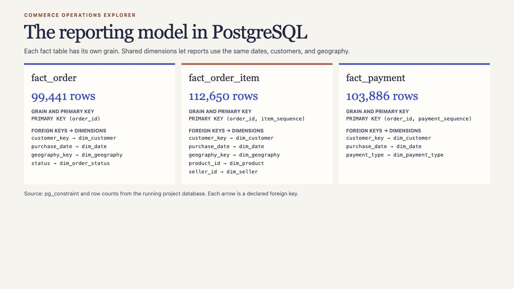

# Commerce Operations Explorer

Reliable sales and delivery reporting from historical marketplace records. I built this independent project to keep orders, items, and payments at the correct grain, reconcile the measures to source data, and make operational comparisons easier to inspect. PostgreSQL, the web application, and Power BI use the same defined analytical model.

The data is anonymized Olist commerce activity from 2016–2018. This is a self-directed historical-data project, not an Olist engagement or an operating retailer. Application requests use live database queries with a bounded 60-second aggregate cache; the source period is historical.

The [portfolio case study](https://bronsonhatch.com/#work/commerce-operations-explorer/build) includes PostgreSQL schema screenshots, a walkthrough of the SQL and verification results, and Power BI Desktop captures.

## Start locally

Requirements: Docker with Compose, Node 22 or newer, Python 3.12. Tested on Apple Silicon macOS; other operating systems are not yet independently verified.

```sh
python3 scripts/setup.py
docker compose --env-file .env up -d --wait
python3.12 -m venv .venv
.venv/bin/python -m pip install -r requirements.txt
npm ci
.venv/bin/python scripts/download_data.py
.venv/bin/python scripts/pipeline.py
.venv/bin/python scripts/verify.py
npm run build
npm run api
```

Open http://127.0.0.1:8183. Windows users can run the Python commands using `.venv\Scripts\python.exe`. The source archive is downloaded separately; no Kaggle credential is embedded. Data availability and terms are controlled by its publisher.

Run `npm test` for the actual PostgreSQL/API security suite. The suite must use this project's `.env`; never point it at unrelated data. The generated random credentials stay in ignored `.env` files. PostgreSQL binds to loopback only. `docker compose stop` preserves its data volume.

## Architecture and invariants

Original CSVs → preserved `raw` records → typed `core` tables → `analytics` star schema → restricted `api` views → application / Power BI.

The order, order-item, and payment facts have separate grains. Customer identity is distinct from an order-specific customer/address record. Original review IDs are not unique: review records retain a source-row key. Latest-review selection sorts by answer timestamp, creation timestamp, then source row. Category translations have explicit fallback names.

The loader runs inside a transaction with an advisory lock. A failed replacement rolls back. Repeating a loaded source version performs no data mutation. Primary/foreign keys and nonnegative monetary constraints are enforced. Raw files remain the reproducible source, including missing attributes; original review text is excluded from application views.

`evidence/source-manifest.json` records hashes, source coverage, missingness and key profiles. Independent source controls use Python Decimal, not warehouse-derived totals. Known missing values remain missing. Original timestamps have no established timezone; wall-clock values are preserved rather than silently converted.

## Definitions

- Delivered merchandise value: sum of item prices on delivered orders, excluding freight, in BRL. This is not platform revenue or profit.
- Average order value: delivered merchandise value / delivered-order count.
- Eligible delivery: delivered order with both actual and estimated delivery dates.
- Late: actual calendar date is after estimated calendar date.
- Review average: selected latest review per reviewed order. Coverage is reported separately. Delivery/review comparisons are descriptive, not causal.
- Period filters refer to purchase date, including when examining delivery outcomes.

## Security and permissions

SQL templates are fixed; values use driver parameter binding. Sort and query identifiers map to application-owned choices. There is no arbitrary-SQL endpoint. The runtime role can select only approved views and cannot modify records, create tables or read raw data. Administrative credentials never reach client code.

Input bodies are streamed with a 4 KiB cap, text is capped at 200 characters, rows at 100, pagination at 5,000, and database statements at five seconds. Native rate-limiter bindings are used when supplied. Otherwise the Worker uses bounded per-isolate, one-minute client windows; this fallback is approximate and not a global budget or denial-of-service guarantee.

React text rendering and context-safe DOM usage preserve untrusted strings as text. CSP, MIME-sniffing protection and framing restrictions add defense in depth. Tests demonstrate covered paths; they do not certify the absence of every vulnerability. Dependency audit results are recorded per release.

The initial Vite dependency tree included an unpatched picomatch advisory. This release uses a smaller esbuild build pipeline with the same React/TypeScript application instead. No vulnerable development server is exposed.

## Performance and recovery evidence

`evidence/benchmarks.json` retains all samples, plans, resource context, medians and p95s. Valid baseline and optimized copies are restored from a common prepared-data backup. Optional performance indexes differ; primary keys and integrity constraints remain. Comparisons alternate execution order after warm-up and verify identical rows. The monthly-summary comparison reports refresh cost. Results include regressions; speed is not promised for every query or machine.

The one-million-order synthetic benchmark is isolated from business tables. Its customer-history latency and 1/5/10-client workloads are not measurements of public-site capacity. Planner cost is an estimate in arbitrary units, not money. Local elapsed SQL times and hosted network round trips are different measures.

To reproduce a fresh benchmark after preserving earlier evidence:

```sh
npx tsx --env-file=.env scripts/export-queries.ts
.venv/bin/python scripts/benchmark.py
```

The script refuses existing named benchmark databases. It restores a prepared backup into fresh databases and verifies source control totals. It never runs on a remote host. Raw CSVs remain separately available for rebuilding source tables. Record backup restoration, not merely backup creation, as recovery evidence.

Aggregate responses use a per-instance, 100-entry, 60-second cache keyed by the SQL template and bound parameters. Cache hits report `source: cache`, their age, and zero database round trips. Order and customer detail remain uncached. Errors are never cached. This reduces repeat calls while allowing up to 60 seconds of staleness; it is not a shared global cache.

## Power BI

[Explore the interactive sales and delivery report on BronsonHatch.com](https://bronsonhatch.com/#work/commerce-operations-explorer/screenshots). The portfolio version uses the verified Power BI snapshot and opens in a browser without a workbook download.

`powerbi/` contains the supported PBIP/PBIR project, a JSON semantic model, ten analytical tables, seventeen DAX measures, and single-direction relationships. Regenerate exports with `.venv/bin/python scripts/powerbi.py`. Change the SourceFolder parameter to your extracted `data` folder before refreshing. The authored defaults point to the project's Windows VM folder.

Schema validation and actual Desktop verification are separate. Consult release evidence for refresh/save/reopen and DAX reconciliation status. No hosted database credentials are included in the report. Do not publish a candidate as a verified PBIX before its Desktop checks pass.

## Hosting and maintenance

Prepared tables are hosted on Neon's Free PostgreSQL plan. The web/API build targets Cloudflare Workers through Sites. Raw geography and synthetic benchmarks remain local. The full prepared database fits the 350 MiB project budget; source coverage is visible in Engineering. No paid upgrade is authorized by setup scripts.

Idle compute can sleep and free quotas can disable live requests. The application exposes errors while keeping documentation available. `QUERIES_ENABLED=false` disables query execution. Never add continuous polling merely to prevent sleep. Recheck provider allowances before publication or substantial changes.

Release source changes through Git, rerun affected checks, build, package the exact commit, and verify deployed behavior. Keep secrets out of source and artifacts. Never run a destructive restore against the live database; restore into a new database and validate before switching.

## Authorship and data rights

Bronson Hatch is the project owner. Codex assisted with implementation, testing, and documentation. This repository and its evidence describe completed work and limitations; they do not imply unassisted implementation, commercial deployment, or business savings.

Original application code: MIT, see LICENSE. Data: Olist, Brazilian E-Commerce Public Dataset, https://www.kaggle.com/datasets/olistbr/brazilian-ecommerce, CC BY-NC-SA 4.0. Data and derived data retain their applicable attribution/noncommercial/share-alike terms; the code license does not relicense the dataset.

Power BI text formatting follows [Microsoft PBIR textbox guidance](https://github.com/microsoft/skills-for-fabric/blob/main/skills/powerbi-report-cli/references/authoring/textbox.md).




